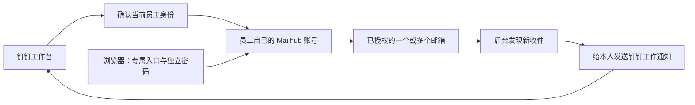

# Mailhub · 钉钉邮箱工作台

**在钉钉里打开自己的多个邮箱，在普通浏览器继续使用同一个账号，新邮件通过个人工作通知提醒。**

Mailhub 是可自托管的企业邮箱入口，基于 Nextcloud Mail，增加钉钉企业身份登录、员工账号隔离、个人新邮件提醒和管理控制台，并提供 Ubuntu 部署与维护脚本。原有腾讯、阿里等邮箱继续使用，不需要迁移公司的邮件域名。

公司只发布一个钉钉企业内部网页应用。员工首次进入时自动建立自己的 Mailhub 账号，再分别授权自己的邮箱；之后从工作台打开即可使用。员工也可以在钉钉内设置独立网页登录密码，两种入口对应同一个账号和同一组已绑定邮箱。

[新手部署路线](docs/QUICKSTART.md) · [完整部署手册](docs/DEPLOYMENT.md) · [员工手册](docs/USER-GUIDE.md) · [管理员手册](docs/ADMIN-GUIDE.md) · [维护手册](docs/OPERATIONS.md)

## 解决哪些问题

| 使用中的问题 | Mailhub 的处理方式 |
| --- | --- |
| 不同邮箱分散在多个客户端，员工反复找入口。 | 从钉钉工作台或统一网页进入，在个人账号内添加多个邮箱。 |
| 钉钉与邮箱系统分开，需要逐个分发另一套初始账号。 | 首次免登建立独立账号；员工自行设置网页登录密码，不使用公共密码。 |
| 企业自定义邮箱域名难以自动找到收发服务器。 | 优先按域名和已核实的 MX 记录识别国内服务商；识别阶段不接触密码。 |
| 电脑关机或忘记打开邮箱页面后，容易错过新邮件。 | 服务器后台同步并发送个人工作通知，不依赖员工电脑一直开着。 |
| 新邮件被其他客户端标为已读后漏掉提醒。 | 按新增收件记录检测，已读状态不排除新邮件；反复改已读不会重复通知。 |
| 管理员不清楚谁已接入、哪些提醒出错。 | 查看员工映射、绑定邮箱、访问状态、后台任务及通知错误。 |

这里的“钉钉集成”是企业内部网页应用，邮箱界面来自 Nextcloud Mail。它不替换钉钉内置邮箱产品，也不改变服务商的反垃圾判断、部门群分发规则或发信额度。

## 员工使用流程



1. 在公司钉钉工作台打开“公司邮箱”，名称可由管理员修改。
2. 首次在 Mail 中填写完整邮箱地址并授权；服务商要求授权码时，使用客户端授权码。
3. 以后从工作台进入即可；添加第二个邮箱时，单独授权该邮箱。
4. 可选：在“个人设置 → 网页登录”设置独立密码，收藏专属链接，用普通浏览器继续使用。
5. 管理员开启提醒后，新邮件通知只发给本人；点击通知，电脑进入钉钉应用工作区，手机走钉钉内网页入口。

钉钉身份验证只解决“你是谁”，不会自动获取邮箱密码，也不能代替邮箱服务商授权。钉钉密码、邮箱授权码和 Mailhub 网页登录密码各自独立。

## 已实现功能

| 范围 | 当前能力 |
| --- | --- |
| 钉钉登录 | 企业内部 H5 应用、员工免登、入口重新核验身份、电脑和手机通知跳转。 |
| 独立账号 | 根据企业和员工标识稳定映射 Nextcloud 用户；保留本地管理员入口。 |
| 网页登录 | 员工自行设置或重设密码、复制用户名、收藏预填用户名链接；更改密码后退出全部旧会话。 |
| 邮件使用 | 复用 Nextcloud Mail 的多账号、收信、发信、回复、文件夹和附件能力。 |
| 自动发现 | 腾讯/阿里企业邮箱按已核实 MX 匹配；QQ/Foxmail、网易个人邮箱、阿里云个人邮箱按明确域名匹配。 |
| 个人提醒 | 默认每轮合并新增邮件，无额外摘要等待；持久去重、有限退避重试、投递结果查询、不确定结果不盲目重发。 |
| 管理控制台 | 配置状态、员工及邮箱概览、停用与令牌撤销、全局/个人提醒开关、错误和后台状态。 |
| 自托管维护 | Docker Compose、高端口 HTTPS、DNS-01 证书、续期、备份恢复、受控更新与诊断脚本。 |

## 邮箱支持范围

每种准备开放的邮箱都应单独验证授权、收信和发信；提供配置入口不等于所有企业租户已经验收。

| 邮箱类型 | 本项目的接入方式 | 需要准备 |
| --- | --- | --- |
| 腾讯企业邮箱 | 按企业域名 MX 提供预设，也可手动配置。 | 允许客户端访问，使用租户要求的授权信息。 |
| 阿里企业邮箱 | 按企业域名 MX 提供预设。 | IMAP/第三方客户端权限，按策略使用客户端安全密码。 |
| QQ / Foxmail 邮箱 | 已知域名预设。 | 开启服务并获取授权码；Foxmail 邮箱地址与 Foxmail 桌面客户端是不同概念。 |
| 网易 163 / 126 / Yeah | 已知个人邮箱域名预设。 | 开启服务并获取授权码；企业邮箱不能直接套用个人版预设。 |
| 阿里云个人邮箱 | `aliyun.com` 域名预设。 | 与阿里企业邮箱区分配置，按账号要求授权。 |
| Gmail | Nextcloud Mail 的 Google OAuth，需额外配置。 | Google 项目、回调、授权范围、网络及实际授权流程。 |
| Microsoft 等 OAuth 邮箱 | Nextcloud Mail 对应提供商的配置能力。 | 对应平台应用注册、租户授权与单独联调。 |
| 其他自定义邮箱 | 原生自动发现或手动 IMAP/SMTP。 | 服务商提供的地址、端口、TLS 与认证方式。 |

精确参数和官方依据见 [服务商目录](docs/MAIL-PROVIDERS.md)。未知或冲突的域名不会被本插件盲目匹配，也不会拿密码向多家服务商轮流尝试。仅有 POP3、网页入口或不允许第三方访问的邮箱，不属于通用 IMAP/SMTP 接入范围。

## 部署与开放顺序

适合能管理 Ubuntu、DNS、HTTPS 和钉钉企业应用的团队。部署目标是 Ubuntu 24.04 LTS、已有 Docker Engine/Compose v2、固定目录 `/opt/mailhub`。先看 [新手路线](docs/QUICKSTART.md)，逐条命令在 [部署手册](docs/DEPLOYMENT.md)。

从公开仓库取得源码，例如在自己的暂存目录执行：

```bash
git clone https://github.com/minnana/mailhub-dingtalk.git
cd mailhub-dingtalk
```

这只是取得源码，不会启动服务。不要直接覆盖已有 `/opt/mailhub`；首次放置与后续更新分别按部署、维护文档执行。

| 步骤 | 要做什么 | 完成标准 |
| --- | --- | --- |
| 1. 准备服务器 | 检查资源、现有业务、Docker 网络、DNS 和出站连接。 | 新项目端口、网段和资源无冲突。 |
| 2. 规划统一地址 | 配置域名；需要外网使用时配置公网入口和端口映射，可用分裂 DNS。 | 内外网使用同一个完整 HTTPS 地址，例如 `https://mailhub.example.com:18443`。 |
| 3. 初始化 | 放置源码、编辑初始化样例、运行 `scripts/bootstrap.sh`。 | 服务器生成独立 `runtime/`，密码写入受限文件。 |
| 4. 配置证书 | 按 DNS 验证方式完成授权与签发。 | HTTPS 证书有效；DNS-01 无需占用公网 80/443。 |
| 5. 配置钉钉 | 创建一个企业内部网页应用，设置首页、权限、使用范围和服务器参数。 | CorpId、Client ID/Secret、AgentId 属于同一企业应用；先开放试点人员。 |
| 6. 启动检查 | 启动固定版本服务并运行健康检查。 | 服务、版本、证书和后台调度正常，本地管理员入口可用。 |
| 7. 员工试用 | 先用 3–5 人验证免登、网页登录、收发、附件及个人提醒。 | 两名员工相互隔离，真实业务通过。 |
| 8. 安排维护 | 证书续期、独立备份位置、备份定时器和恢复演练。 | 管理员能查错、恢复和升级，再分批扩展。 |

高端口必须在自己的网络与钉钉客户端验证；公网无法使用 443 时，所选高端口仍须真实入站可达。DNS 记录不能代替路由器映射或防火墙规则。

初始化脚本检查已有 Docker，不会安装或重启 Docker，也不会修改其他应用的全局配置。它不负责重新配置已有系统；域名、端口、网络和版本变更请走 [维护流程](docs/OPERATIONS.md)。

### 常用入口

将示例域名替换为自己的地址：

| 入口 | 地址/操作 |
| --- | --- |
| 钉钉首页 | `https://mailhub.example.com:18443/` |
| 普通账号密码登录 | `https://mailhub.example.com:18443/index.php/login` |
| 员工网页登录设置 | 头像 → 设置 → 网页登录；登录后也可访问 `/index.php/apps/mailhub_dingtalk/personal`。 |
| 管理控制台 | `https://mailhub.example.com:18443/index.php/apps/mailhub_dingtalk/admin` |

员工从自己的个人页收藏专属链接，无需反复输入较长的系统用户名。该链接只预填用户名，不含密码或免密令牌。不要用管理员账号替全公司绑定邮箱。

## 提醒规则与使用边界

- **监测新增收件，不是统计全部未读。** 检测 INBOX 中基线之后新增、未删除且不是草稿的邮件；已在其他客户端读过仍会计入，垃圾箱和其他文件夹不在范围内。
- **首次使用不补推历史。** 首次建立基线、重新开启提醒等场景从当时状态开始。旧邮件移回 INBOX 并获新编号时，可能被视为新收件。
- **每分钟调度不等于一分钟内必达。** 后台每分钟启动一轮，结束后追加通知扫描，默认无额外摘要等待。长任务、同步、锁、网络和钉钉投递仍会造成延迟，见 [架构说明](docs/ARCHITECTURE.md)。
- **通知不包含邮件内容。** 只发送新增数量、入口链接和时间，不发送主题、正文或附件。已提交任务的回执查询不阻塞后续新批次；结果不确定的任务不自动重发。
- **离职需要明确停用。** 暂停免登、缩小钉钉可见范围或修改允许名单，不等于禁用已有网页登录密码。撤销本系统访问应使用“停用并退出会话”；当前没有离职事件自动订阅。
- **原邮箱权限另行管理。** 停用 Mailhub 不会退出原邮箱网站及其他客户端，也不会注销原邮箱账号。
- **本地备份不是全部邮件归档。** 原邮件由服务商保存，本地仍有受保护的账号凭据、索引/缓存和文件；备份需要同等保护。

Gmail、未验证设备和不同服务商租户需要独立验收。每分钟检查会增加邮箱连接和后台负载；200 人各绑定 1–2 个邮箱，应按 200–400 个账号分批验证容量，不能只按同时打开页面的人数估算。

## 技术栈与兼容范围

| 部件 | 本仓库部署基线 |
| --- | --- |
| 主机 | Ubuntu 24.04 LTS，Docker Engine / Compose v2 |
| 邮件应用 | Nextcloud 34.0.5 Apache + Mail 5.12.5 |
| 自定义插件 | `custom_apps/mailhub_dingtalk`，版本 0.1.0 |
| 数据库与缓存 | MariaDB 11.4、Redis 7.4、APCu |
| HTTPS | Nginx + acme.sh；默认主机端口 18443 |
| 证书验证 | `dns_acmedns`、`dns_tencent` 或 `dns_dp` |
| 后台调度 | 每分钟 Nextcloud cron、同轮结束后的通知扫描、systemd 证书/备份定时器 |

镜像和 Mail 包摘要见 [版本清单](templates/versions.env)。固定版本便于复现，不替代安全更新。免登目前限制 Nextcloud 34，快速同步只针对已核对的 Mail 5.12.5；升级前先审查适配并在测试环境验证，不要直接改为 `latest`。

## 文档导航

| 读者/任务 | 文档 |
| --- | --- |
| 初次接触，按顺序准备 | [新手路线](docs/QUICKSTART.md) |
| 安装、域名、证书与应用 | [部署手册](docs/DEPLOYMENT.md) |
| 员工绑定、网页登录、收发和提醒 | [员工手册](docs/USER-GUIDE.md) |
| 开放人员、访问控制、通知和 Gmail 接入 | [管理员手册](docs/ADMIN-GUIDE.md) |
| 检查、备份、恢复、升级和排障 | [维护手册](docs/OPERATIONS.md) |
| 多网关下可选的 HTTPS 回程策略 | [回程配置](docs/RETURN-ROUTE.md) |
| 邮箱参数与识别依据 | [服务商目录](docs/MAIL-PROVIDERS.md) |
| 登录、同步和通知的实现 | [架构说明](docs/ARCHITECTURE.md) |
| 权限、凭据与公开源码 | [安全说明](SECURITY.md) |
| 自动测试和真实联调记录 | [测试与验收](docs/VALIDATION.md) |

## 源码与运行数据

```text
mailhub/
├── compose.yaml
├── custom_apps/mailhub_dingtalk/  # 钉钉登录、管理、发现与提醒插件
├── scripts/                      # 部署和维护脚本
├── templates/                    # 通用模板及固定版本
├── docs/                         # 公开文档
└── runtime/                      # 运行服务器生成，不属于公开源码
    ├── .env
    ├── secrets/                  # 应用、数据库、DNS 和管理员凭据
    ├── config/
    ├── data/                     # 应用数据、数据库、证书和 ACME 状态
    ├── downloads/
    └── logs/
```

不要提交 `runtime/`、备份、日志、浏览器 Cookie、员工信息或密钥；`.gitignore` 不能替代提交前检查。问题报告仅附脱敏的版本、现象和必要错误信息，安全问题按 [SECURITY.md](SECURITY.md) 处理。

## 许可证

原创部署脚本与配置模板使用根目录 [MIT License](LICENSE)。自定义 Nextcloud 插件使用 AGPL-3.0-or-later，见插件目录许可证。Nextcloud、Mail、数据库、代理和其他第三方组件保留各自许可证。
